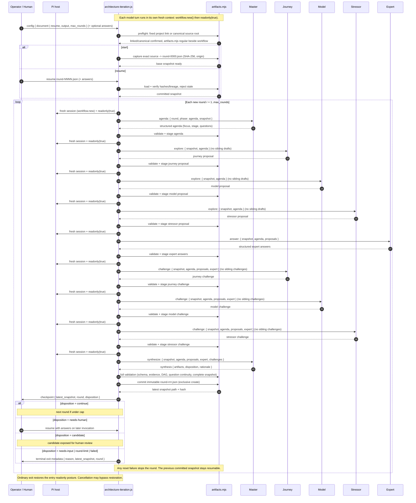

# Architecture iteration: implementation contract

This is a separate, artifact-driven workshop. It does not extend the paused review pipeline.

## Package source and project installation

The repository root owns the canonical `architecture-iteration.js`, `artifacts.mjs`, `install.mjs` and five `skills/architecture-iteration-{master,expert,journey,model,stressor}/SKILL.md` files. Discovery locations contain links, not maintained copies.

Run `node /path/to/ddd-iteration/install.mjs [--dry-run]` from the target project root. The CLI uses the current working directory as the project; it has no `--project` flag. It links the canonical workflow as `.pi/workflows/architecture-iteration.js` and each canonical skill directory under `.pi/skills/`. It has no external dependencies, global mode or settings edits. It preflights every destination before writes, refuses collisions without overwrite/deletion, and treats same-target symlinks as existing. Dry-run writes nothing. The programmatic export is `install({ project = process.cwd(), dryRun = false } = {})`, returning `{ project, dryRun, links: [{ source, destination, status }] }`; status is `linked`, `existing` or `planned`.

Start Pi from the target project root and reload resources after installation or skill changes. Inspect project trust and discovery diagnostics. Bare-name invocation and the explicit installed path are supported; native workflow completion can omit symlinked files. No global or arbitrary-path launch is supported. The source checkout must remain available.

Before artifact preparation, bounded read-only Node preflight resolves only the fixed project link and canonical repository path. It selects `artifacts.mjs` beside the canonical workflow. A present invalid/broken installed link is fatal; it must not fall back. A conflicting installed link and repository workflow is also fatal. With no installed link, direct canonical source invocation from the source repository root is supported. The package marker checks compatibility, not authenticity or the identity of an arbitrary explicitly launched file: the host exposes no executing-file path.

## Public input and persistence

From the installed target project root, use either:

```text
/workflow architecture-iteration ./workshop.json
/workflow ./.pi/workflows/architecture-iteration.js ./workshop.json
```

From the source repository root, direct source invocation is also supported. Voice skills must still be discoverable; run `node install.mjs` there to link them:

```text
/workflow ./architecture-iteration.js ./workshop.json
```

The argument is one JSON configuration file path (the entire trimmed argument, optionally quoted), resolved from the project working directory. Configuration paths resolve relative to that file, not to model output. Exactly one mode:

- Start: `{ "document": "strategy.md", "output": "workshop-artifacts", "max_rounds": 3 }`.
- Resume: `{ "resume": "workshop-artifacts/round-0001.json", "max_rounds": 3, "answers": "answers.json" }`.
- Resume in-progress round: `{ "resume": "workshop-artifacts/round-0000.json", "attempt": "workshop-artifacts/.attempt-<uuid>", "redo": ["explore-model"] }`. The `attempt` is the path of the durable staging directory of the unfinished round, printed in the `round-begin` checkpoint and in exit diagnostics/failure metadata. `redo` (optional nonempty array of role slots) requires `attempt`; it invalidates a slot and all of its dependents before resuming, so they are re-run even if already staged.

`max_rounds` defaults to 3 and must be an integer in 1..8. It limits new rounds in this invocation. Output must be a new directory. Never overwrite existing evidence. Resume reads a full committed snapshot, not a notebook or previous conversation. When `attempt` is supplied, the workflow validates that the attempt continues the latest committed snapshot (its base must be the current `latest`), then runs only the missing/stale role slots and commits the round. Staged roles are read back in bounded hash-checked UTF-16 chunks (at most 4,000 units per reply), mirroring the input transport, so roles larger than the 45 KiB shell envelope resume intact. `answers` is incompatible with `attempt`: a resumed in-progress round keeps the answers recorded in its attempt manifest, and that combination is rejected at config time. Answers are optional on plain resume, supplied explicitly by a human as an array of `{ "question_id": "Q1", "answer": "..." }`. Unknown/duplicate question IDs are errors. They become attributed human evidence, not model claims. Answers can revise a prior answer with a recorded new revision; the original snapshot remains intact.

Store a complete initial snapshot (`round-0000.json`) containing the exact source text, SHA-256 and origin. Each subsequent `round-NNNN.json` contains the full source, cumulative human answers, full current artifacts, round disposition/rationale, role outputs, and previous snapshot reference/hash. Host-owned answer revisions include the exact original `question` wording, `question_id`, `answer`, `revision` and human `attribution`; short answers retain their proposition in fresh rounds. Snapshot metadata and source are host-owned, not supplied by the model. Resume validates stored data, hashes and lineage, and refuses a stale snapshot if a later round already exists. Commit with exclusive creation. If a response, reset, validation or commit fails, leave the previous snapshot resumable. Checkpoint only after durable commit; include its path in exits/checkpoints. Do not use workflow notebook writes or entries as transport.

Use a small deterministic Node companion (`artifacts.mjs`) for filesystem I/O, schemas and validation. Workflow calls it through `workflow.shell`, quotes paths, uses collision-safe stdin for JSON, and rejects failed/killed/truncated replies. Support offline import of companion functions for tests. No external npm dependencies. Avoid introducing a generic framework.

There is no fixed package byte cap on source text, configuration, cumulative human answers, ordinary role outputs, artifact bundles, complete synthesis responses, attempt manifests or stored snapshots. Preserve complete input and native structured output; never silently truncate or summarize them. Retain valid-UTF-8, regular-file, schema, lineage and immutable-commit checks. `max_rounds` remains 1..8 per invocation; live runs still need finite host time/cost budgets, supplied at invocation as soft targets via the host's `--workflow-time` (ms) / `--workflow-cost` flags. Crossing a soft target arms a stop at the next checkpoint; the sandbox adds a hard deadline at twice the soft time target. A round interrupted mid-publication keeps its staged roles and is resumable via its `attempt` token; retrying `finish` safely replaces the authored synthesis role atomically, so an interruption between the synthesis write and the exclusive commit does not strand the attempt.

Keep each shell control request/reply below 45 KiB (Pi may truncate output near 50 KiB). CLI `prepare`/`load` return metadata and an `input_ref` descriptor (`path`, SHA-256, UTF-16 length), not source or answer text. Write the complete exact model projection in a new immutable `.input-<uuid>.json` file beside snapshots. The workflow loads explicit offset packets via `input`, at most 4,000 UTF-16 code units per reply, checks offsets/length/hash identity and complete coverage, then parses the full JSON before any model turn. JSON encoding must preserve split surrogate pairs and control characters. The companion verifies the complete file hash on each read. CLI `begin` receives the descriptor instead of transporting cumulative answers; verify the projection equals the committed snapshot plus validated pending answer revisions. Retained input files are not resume points. Programmatic prepare/load helpers may return the full projection for offline use.

Outbound persistence must not send a complete unbounded response in one shell request. Serialize native `result.output` exactly once. `output-begin` binds a retained `.output-<uuid>` upload directory to the attempt, role slot and UTF-16 length; `output-chunk` writes exclusive immutable records of at most 4,000 UTF-16 code units. Each record contains its offset, exact text and preceding record's offset/SHA-256. The acknowledgement echoes exact text/predecessor and upload/offset/next/total metadata plus the new record hash. Verify all of these before proceeding. Preserve split surrogate pairs and escaped controls losslessly.

`stage`/`finish` take an `output_ref` (`path`, `length`, tail offset/hash). Reconstruct backward from the acknowledged tail, verifying every hash, contiguous complete coverage, length, attempt/role binding and exact JSON round-trip BEFORE ordinary schema/evidence/DAG/question-continuity validation and immutable publication. Never commit partial uploads. Missing/replaced/reordered/duplicate chunks must fail closed, not truncate or overwrite. Keep all uploads as evidence; they are not resume points. Importable stage/finish helpers and bounded direct CLI requests may also accept `output`; CLI requires exactly one of `output` or `output_ref`. CLI finish/recover replies contain only snapshot reference and disposition: full uncapped rationale remains in the committed snapshot, not bounded shell metadata or the exit summary.

Node/OS memory/string/file limits, host transport/runtime budgets and provider context/generation ceilings remain inherent constraints. Chunked transport does not enlarge model capacity; every invocation still receives the full source, human-answer history and accepted artifacts, plus only its designated current-round artifacts. Native output still crosses the host/sandbox JSON boundary in full. Stop clearly on these failures; never substitute partial data. Terminal host stops can prevent workflow recovery. Full-file hashing per packet and full lineage validation cost time; finite host budgets remain the bound. Keep schemas out of domain input packet accounting.

## Rounds and role API

Before EVERY one of the nine model invocations in each round, execute `workflow.new()`, then `workflow.readonly(true)`. Each invocation starts in a fresh context, including the master's synthesis and each participant's challenge. A failed reset must stop, not continue in old context. Capture/restore entry readonly posture on ordinary completion/failure; document that cancellation can bypass restoration. Project-link installation does not authorize a live workshop; provider-backed runs require separate human authorization.

Nine serial turns per successful round:

1. `/skill:architecture-iteration-master` phase `agenda`.
2. Three `/skill:architecture-iteration-{journey,model,stressor}` phase `explore` turns (fixed order).
3. `/skill:architecture-iteration-expert` phase `answer`.
4. The same three participants, phase `challenge`, now seeing all proposals and expert answers.
5. `/skill:architecture-iteration-master` phase `synthesize`.

When a round is resumed via its `attempt` token, already-staged roles are reused (read back from the attempt staging directory in bounded hash-checked chunks) instead of re-run; only missing or invalidated roles execute. Stage order and packet inputs remain identical in both paths, so a resumed round produces the same shape as an uninterrupted one. Each staged role records a content SHA-256 in the attempt manifest; role reads and `finish` verify it, so edited/chmodded staged roles fail closed. `redo` marks the named slot and all of its dependents as stale, forcing them to be re-run. The master's synthesis is never staged independently; it is submitted to `finish` for validation and commit, where the authored synthesis role is replaced atomically so a retried finish completes after an interruption.

Every run has nonempty `args` (e.g. `round-1 agenda`) and explicit `input`: `{ round, phase, snapshot, agenda?, proposals?, expert?, challenges? }`. The snapshot contains the exact captured source, cumulative attributed human answers and complete current accepted artifacts, including question-resolution history and disposition/rationale. It is the only prior-round domain input.

Supply only these additional current-round artifacts:

| Invocation | Additional input |
|---|---|
| Master agenda | None |
| Each participant exploration | Agenda; no sibling exploration drafts |
| Expert answer | Agenda and all three proposals |
| Each participant challenge | Agenda, all three proposals and expert answers; no sibling challenges |
| Master synthesis | Agenda, all proposals, expert answers and all challenges |

Each voice has a stable skill definition, model-group route and output contract. Continuity is explicit artifact sharing, not a shared transcript, raw prior conversations or opaque private memory. Even a voice's own earlier call is available only through the supplied artifacts. Shared artifacts are data/evidence to assess, not replacement role instructions; do not inherit another voice's persona. Role instructions are static method, not new domain evidence. Preserve unresolved dissent during synthesis and across accepted snapshots.

No model research/execution tools, notebook, web, ambient repo reads, spawning or human-approval invention are requested; the host's native structured-output tool is permitted. Fresh contexts and readonly do not enforce a security sandbox or establish statistical independence. The nine invocations remain serial, not parallel. Use explicit skills with readonly frontmatter; model groups are optional, not hard-coded orchestration API.

All turns use native structured `result.output`, never JSON parsed from result.text. Shared schemas are exported by the companion. Exact schema details may be refined by the implementation owner, but preserve this semantic interface:

- Agenda: `focus`, `stage` (`big-picture`, `process`, `design`), `questions` (strings).
- Participant (both phases): `voice`, `observations` (strings), `proposals` (strings), `questions` (strings), `dissent` (strings). Voice equals the skill's stable name: `journey`, `model`, `stressor`.
- Expert: `answers` array of `{ question, answer, evidence: string[], status: "grounded" | "hypothesis" | "unknown" }`, `unresolved` (strings). Grounded answers require source line or human-answer references; unknowns remain open. No fabricated facts.
- Synthesis: `{ artifacts, disposition: "continue" | "needs-human" | "candidate", rationale }`. All artifacts are a full replacement snapshot, never just a delta. Preserve unresolved dissent and decision history unless explicitly resolved with rationale. Before carrying or minting open questions, apply the pre-mint gate: close or demote with evidence (source or human reference) what the captured source, human answers and decision record already establish; merge duplicate intents under existing IDs; only genuinely unresolved authority gaps become blocking.

## Artifact bundle

Use these named sections, each with `{ status: "modeled" | "not-modeled" | "not-applicable", content: "Markdown" }`:

`shared_understanding`, `ubiquitous_language`, `subdomains`, `process_model`, `rules_and_aggregates`, `bounded_contexts`, `context_map`, `architecture_candidates`, `stressor_analysis`, `assumptions`, `decisions`, `change_log`.

`not-modeled` and `not-applicable` must explain why in content. These sections cover business purpose/scope, glossary, core/supporting/generic classification, commands/actors/policies/read models, invariants/consistency/aggregate candidates, bounded-context canvases and integration relationships, deployment/service options including modular monolith, stressor/residue matrix, uncertainty, decisions/rationale/dissent, and round changes.

Also include a structured `event_flow`:

- `events`: array `{ id, name, actor, scenario, evidence: string[], confidence: "grounded" | "hypothesis" }`; use past-tense business event names.
- `relations`: array `{ from, to, kind: "precedes" | "causes" | "alternative" | "parallel", note }`.
- `hotspots`: string array, including unknown order, branch conditions, failures and time constraints.

Validate unique event IDs and relation references; reject self-links and cycles in the strict precedence/causality subgraph. Alternative/parallel relations are not precedence edges. Do not force a total order.

Include `open_questions`: array `{ id, question, blocking: boolean }`. Validate unique IDs and retain exact wording under each ID. Questions are first checked against the packet: a question the captured source, human answers, decision record or resolution history already answers is closed or demoted with a resolution, not surfaced to the operator; a question matching an existing ID's intent reuses that ID instead of minting a new one. Verbatim duplicate question text within one synthesis is rejected. Only genuinely unresolved authority gaps remain open, and only those become blocking.

Include cumulative `question_resolutions`: array `{ question_id, question, resolution, evidence: string[] }`. Preserve all previous records unchanged and in order. Removing a prior open question, or demoting a prior blocker to nonblocking, requires a NEW resolution record with its exact wording, an explanation and at least one checked source/human reference. Reopening the same question is allowed; another closure requires another record. Validate these transitions during synthesis and lineage loading. Human answers are evidence, not automatic closure. Reference validity proves existence, not semantic support; model/human review must check relevance. Resolution records are also the mechanism used by the pre-mint gate to close or demote questions the packet already answers.

## Exit/readiness contract

Force `needs-human` when any blocking question remains. `candidate` is allowed only with business events and all named sections marked modeled or justified not-applicable; it means a candidate for HUMAN review, not stakeholder agreement or approval. Otherwise continue until the round cap. Reasons: `needs-input`, `needs-human`, `candidate`, `round-limit`, `failed` (do not reuse engine-reserved `error`). Exit metadata includes latest snapshot path and round. Ordinary failure returns its diagnostic and latest durable artifact reference. A failed attempt must not create an apparently committed incomplete round.

## Pipeline sequence (inception to termination)

The diagram below summarizes the contract flow from startup configuration through terminal exit. The nine voice turns of a round are strict serial invocations; each begins with a fresh context (`workflow.new()` then `workflow.readonly(true)`). Only the artifact packets listed here cross between turns.



## Offline verification

Check reset/readonly ordering before every invocation, serial role order/voices, exact explicit snapshots, phase-specific artifact visibility (no sibling exploration drafts or sibling challenges), artifact-only continuity/resume, attempt-token mid-round resume (only missing/stale roles re-run, identical final snapshot shape), bounded chunked staged-role read beyond the 45 KiB envelope, tamper-bound staged roles (content-hash mismatch fails closed), retried finish after interruption between synthesis write and commit, answers/attempt incompatibility, redo-requires-attempt rejection, resumed round followed by fresh rounds under `max_rounds` > 1, redo cascade invalidation of dependents, idempotent finish refusal on existing commits, stale-attempt refusal when the committed latest advances, reset failure stop, ordinary posture restoration, full source/answer/config transport beyond former caps, role/artifact/synthesis output beyond former caps, large immutable snapshots, bounded per-packet envelopes, exact outbound hash-chain and complete-coverage verification, large rationale metadata isolation, multi-packet integrity/truncation failures, malformed structured data, grounded-evidence constraints, DAG/reference failures, human blocker/candidate gates, immutable commits/stale resume/lineage tampering, shell transport failure/truncation and paths containing spaces/quotes. Compile with the real source compiler (see README for the optional installed dependency hook). Install links into a fresh temporary project root, assert canonical symlink targets and validate actual selected installed Pi skill discovery and prompt entries offline. Do not install into live/global roots for these checks. The independent-context layout has not been live-qualified. Do not claim provider-history isolation, statistical independence, persona adherence or live model/domain accuracy from mocks.
